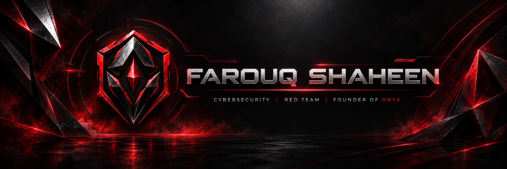
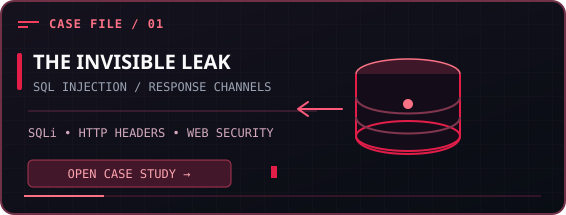
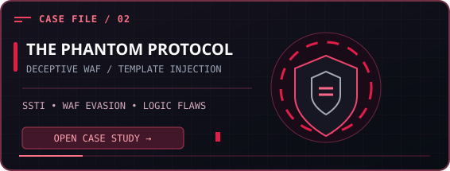
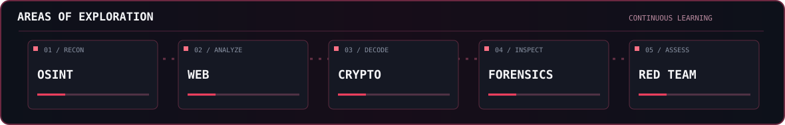

<div align="center">
  

  <p>
    <a href="https://github.com/farouqshaheen"></a>
    
    
  </p>

  <p>
    <a href="https://www.linkedin.com/in/farouq-shaheen-667b24305/"></a>
    <a href="https://www.instagram.com/farouq0_0/"></a>
    <a href="https://github.com/farouqshaheen?tab=repositories"></a>
  </p>
</div>

---

## `> ./field_operations --simulate`

<div align="center">
  
  <sub>A looping SVG illustration of a cybersecurity training simulation. No external scripts, real attacks, or live targets.</sub>
</div>

---

## `> whoami`

```text
┌──(farouq㉿kali)-[~/profile]
└─$ cat about.txt

NAME       : Farouq Shaheen
FOCUS      : Offensive Security · Red Team · CTF
INTERESTS  : Web Security · OSINT · Cryptography
MINDSET    : Understand the system. Challenge the assumptions.
```

I'm **Farouq Shaheen**, a cybersecurity enthusiast from Jordan, focused on **offensive security, ethical hacking, and Capture The Flag (CTF) competitions**. I am the **Founder of ONYX**.

- **Currently exploring:** Red Team fundamentals, web exploitation, OSINT, cryptography, digital forensics, and CTF problem-solving.
- **Hands-on work:** Python, Bash, technical writeups, and security testing labs.
- **Open to:** Cybersecurity internships, collaborative security research, and CTF communities.

---

## `> ./ctf_journey.sh`

| Milestone | Details |
|:--|:--|
| **JordanSec MINI CTF — Top 10** | **10th place overall** in the competition. |
| **BRK-CYS 2026 CTF — Challenge Author** | Designed and documented <a href="https://github.com/farouqshaheen/BRK-CYS-2026-CTF-Writeups">web exploitation CTF challenges</a> involving SQLi, SSTI, and deceptive defenses. |

> **My approach:** Learn how a system is built, understand its logic, then test it responsibly.

---

## `> ls ~/security-research`

**Selected work.** Two real CTF case studies, presented as live mission cards.

<p align="center">
  <a href="https://github.com/farouqshaheen/BRK-CYS-2026-CTF-Writeups/blob/main/The%20Invisible%20Leak/README.md"></a>
  <a href="https://github.com/farouqshaheen/BRK-CYS-2026-CTF-Writeups/blob/main/phantom-protocol/README.md"></a>
</p>

**Read the writeups:** [The Invisible Leak](https://github.com/farouqshaheen/BRK-CYS-2026-CTF-Writeups/blob/main/The%20Invisible%20Leak/README.md) · [The Phantom Protocol](https://github.com/farouqshaheen/BRK-CYS-2026-CTF-Writeups/blob/main/phantom-protocol/README.md) · [Full archive](https://github.com/farouqshaheen/BRK-CYS-2026-CTF-Writeups)

---

## `> ./exploration-map --live`



<details>
  <summary><strong>Explore the current learning tracks</strong></summary>

  - **OSINT:** Open-source intelligence and investigative approaches.
  - **Web security:** Understanding application logic, SQL injection, and SSTI.
  - **Cryptography:** CTF puzzles, cipher analysis, and RSA fundamentals.
  - **Digital forensics:** Network and artifact analysis in lab challenges.
  - **Red Team:** Offensive-security fundamentals and authorized exercises.

</details>

---

## `> cat toolkit.md`

**Security & Analysis**

<p>
  
  
  
  
  
</p>

**Programming & Scripting**

<p>
  
  
  
  
</p>

**Development Workflow**

<p>
  
  
  
  
  
</p>

---

## `> ./github_stats --live`

<div align="center">
  
  
  <br />
  
</div>

<sub>Statistics are provided by third-party GitHub widgets and may occasionally be unavailable or cached.</sub>

---

<div align="center">

### `> connect --with farouq`

**Interested in CTFs, offensive security, or security research? Let's connect.**

<a href="https://www.linkedin.com/in/farouq-shaheen-667b24305/"></a>
<a href="https://github.com/farouqshaheen"></a>

<br />

*"Build to understand. Break to learn. Secure by design."*

<sub>FAROUQ SHAHEEN · CYBERSECURITY · JORDAN</sub>

</div>
